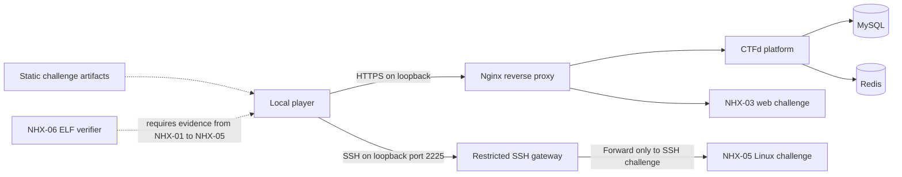

# NoctiHex CTF — Echoes of the Dark Network

A team-built, six-stage cybersecurity CTF that combines digital forensics, web security, Linux system security, and reverse engineering in a locally isolated training environment. The project includes original challenge artifacts, a CTFd platform, containerized services, and automated checks for player workflows, network isolation, resets, and backup recovery.

**Project type:** University penetration-testing / CTF assignment · **Total challenge value:** 1,400 points · **Deployment:** Local lab; no public-hosted instance is claimed.

> **Organizer source:** This repository contains challenge source code, intended solutions, flags, and deployment tooling. Do not distribute it as a player-only challenge pack or expose the intentionally vulnerable services to the public internet.

## Challenge track

| Stage | Theme | Difficulty | Points |
|---|---|---:|---:|
| NHX-01 — Whispers in the Static | Steganography | Easy | 100 |
| NHX-02 — Cipher at Dusk | Cryptography | Easy | 100 |
| NHX-03 — Mirror Account | Web security | Moderate | 200 |
| NHX-04 — Packet After Midnight | Network forensics | Moderate | 200 |
| NHX-05 — Misplaced Trust | Linux / system security | Moderate–Hard | 300 |
| NHX-06 — NoctiCore | Reverse engineering | Hard | 500 |

The stages use four participant artifacts (image, text, PCAP, and Linux ELF), two interactive services, progressive hints, and an evidence chain that feeds the final reverse-engineering stage. Challenge flags, answer strings, and solution walkthroughs are intentionally omitted from this overview.

## Lab architecture



Docker Compose separates the platform, challenge, and backend networks. Host-published services bind to loopback; MySQL and Redis are not published to the host. NHX-05 is reached through a fixed SSH gateway, with controlled isolation tests checking that the challenge cannot reach selected outside destinations.

## Engineering work

- Built and integrated a CTFd platform with six challenge stages, 13 progressive hints, scoring, and story progression.
- Packaged the web and Linux challenges as constrained containers; configured Nginx for local HTTPS access and an SSH gateway for the Linux challenge.
- Wrote setup, reset, platform configuration, player-flow, hash-verification, isolation, and backup/recovery automation.
- Verified challenge downloads against approved SHA-256 hashes and tested that a deliberately corrupted artifact is detected.
- Exported a real platform backup and restored it into a separate Compose deployment and database volume.
- Documented architecture, risks, design changes, defects, evidence, and team contributions.

This is a **team project**. The repository's contribution record documents the role split and the integration/testing work; use that record when describing your own contribution rather than claiming the entire group project individually.

## Validation evidence

Saved local test records report the following results:

| Validation | Recorded result |
|---|---:|
| Live player-flow checks | **59 / 59 passed** |
| Controlled network-isolation checks | **11 / 11 passed** |
| Integration checks after deployment/reset | **7 / 7 passed** |
| Container reset checks | **2 / 2 passed** |
| Player-flow checks against restored backup | **59 / 59 passed** |
| Backup restore | **6 stages, 1,400 points, 13 hints, 4 player files restored** |

The tests cover stage access, correct/incorrect and cross-stage submissions, scoring and hints, web challenge session behavior, SSH challenge boundaries, artifact hashes, reset behavior, and restored player flows. Evidence is recorded in `testing/test-results/`, `testing/hashes/`, and `docs/evidence-index.csv`.

These results describe the tested **local environment and controlled cases**. They do not establish a public production deployment, comprehensive penetration test, or independent human review of challenge difficulty. The capstone's 32-bit mixing check is an educational reverse-engineering mechanism, not cryptographic authentication.

## Technology

**CTFd · Docker Compose · Nginx · MySQL · Redis · Flask · OpenSSH · Python · C / GCC · Scapy · Wireshark · TLS**

## Run the local lab

The documented environment uses Windows 11, Docker Desktop with Linux containers/WSL2, Git, and Python 3.12 or newer. Use an isolated training machine.

1. Copy `.env.example` to `.env` and replace every placeholder with unique local values. Keep `.env` private.
2. Create the Python environment and install the helper-script dependencies:

   ```powershell
   py -3 -m venv .venv
   .\.venv\Scripts\python.exe -m pip install -r scripts/requirements.txt
   .\.venv\Scripts\python.exe scripts/setup-local-cert.py
   ```

3. Add `127.0.0.1 noctihex.local` to the Windows hosts file if needed. The generated certificate does not automatically become trusted by your browser.
4. Validate and start the containers:

   ```powershell
   docker compose config --quiet
   docker compose build
   docker compose up -d
   ```

5. Complete CTFd's first-run setup, then configure the challenge content using organizer credentials stored outside Git:

   ```powershell
   .\.venv\Scripts\python.exe scripts/configure-platform.py
   ```

   The configuration script accepts `CTFD_ADMIN_NAME` and `CTFD_ADMIN_PASSWORD` from the current shell or a private local account file. Do not place real credentials in source control.

The local player URL is `https://noctihex.local`; the SSH lab endpoint is `127.0.0.1:2225`. Use the approved local certificate-trust process rather than disabling TLS verification.

## Repository map

```text
challenges/       Six challenge artifacts, services, and organizer solutions
docker-compose.yml Local platform and challenge network
platform/         Nginx HTTPS configuration and restricted SSH gateway
scripts/          Platform setup, reset, test, and verification tools
testing/          Test cases, saved results, hashes, and defect records
docs/             Architecture, risk, design, contribution, and evidence records
private/          Local organizer accounts and backups; excluded from Git
```

## Security and sharing

- The challenges are intentionally vulnerable and designed for an isolated lab. Keep the services bound to loopback; do not publish them on a public host.
- The repository includes organizer solutions and synthetic challenge answers. Anyone with source access can inspect them.
- Commit `.env.example`, not `.env`. Check that `private/`, account files, backups, generated keys, and local certificates are not staged before making the repository public.
- Use unique local training credentials. Never reuse personal or production passwords.

## Attribution

Created as a four-member university assignment. See [`docs/contributions.md`](docs/contributions.md) for the documented role split and [`docs/architecture.md`](docs/architecture.md) for the system design. This repository is the group's source project; describe individual contributions accurately.

